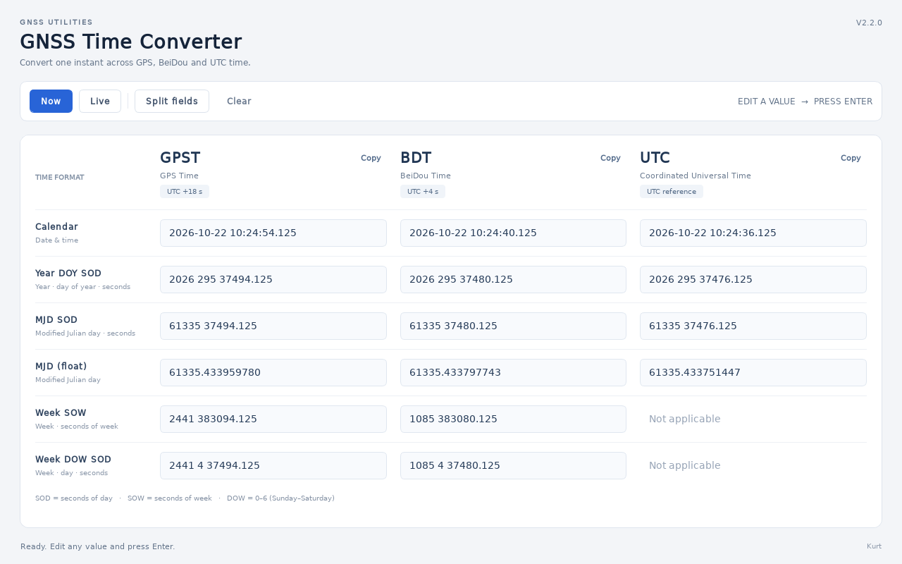

# GNSS Time Converter

UTC、GPST 与 BDT 时间转换桌面工具，基于 Python / PyQt5。



## 下载

从 [GitHub Releases](https://github.com/hhcmg/GNSS_time_convert/releases) 下载 Windows ZIP，完整解压后运行其中的 `GNSS-Time-Converter.exe`。保留同目录的 `_internal` 文件夹。

## 运行

已有项目虚拟环境时：

```powershell
# Windows
.\.venv\Scripts\python.exe main.py
```

```bash
# Linux
.venv/bin/python main.py
```

也可在已安装 PyQt5 的 Python 环境中运行 `python main.py`。

## 界面与操作

浅色对照表按格式排列，从左到右为 GPST / BDT / UTC，三列保持对齐。表头显示当前时刻相对于 UTC 的偏移；小窗口和高 DPI 下通过滚动保留完整输入区。

- 任意可编辑字段输入时间，按 **Enter** 换算；离开字段时也会提交。
- **Now**：设为当前时刻。**Live**：每秒更新，开启时锁定编辑。
- **Split fields**：切换独立子字段；切换保留未提交的草稿和清空状态。
- **Clear**：清空全部可编辑字段。每列表头 **Copy** 复制该系统的 Calendar 值。
- 转换来源以蓝色边框标记。非法输入显示红框和错误原因，并保留之前的有效结果。
- UTC 不使用 GNSS 周格式，相应位置显示 `Not applicable`。

### 输入规则与精度

支持 Calendar、Year DOY SOD、MJD SOD、MJD 小数、Week SOW、Week DOW SOD。

- Calendar 可仅填日期，默认午夜；Year DOY、MJD SOD、Week DOW 的末尾 SOD 可省略，默认 0。
- Split 中每个框只接受一个值；必填框不能留空。平年 DOY 最大为 365，闰年为 366。
- SOD 范围为 `[0, 86400)`，SOW 为 `[0, 604800)`，DOW 为 `0–6`（周日为 0）。
- 所有显示格式统一截断到毫秒；MJD 小数显示 9 位，因此反解析存在小于约 0.05 ms 的小数量化误差（常用 GNSS 日期范围）。
- Python `datetime` 无法表示 UTC `23:59:60`。落在闰秒内的 GPST/BDT 输入会明确报错，避免静默改变时刻；闰秒前后正常时间仍可转换。
- 闰秒表位于 `src/time_conversion.py`，目前记录至 2017-01-01。未来公布新的闰秒后需要更新此表。
- 日期必须能同时由三个系统表示；日期边界溢出会报错并保留原结果。

## 打包

两个平台共用 `scripts/build.py` 和 `GNSS-Time-Converter.spec`。脚本按自身位置定位项目，可从其它目录调用。

### Windows

```bat
build_windows.bat
build_windows.bat clean
```

默认复用 `.venv`。首次运行自动选择 `py -3` 或 PATH 中的 `python`，也可通过环境变量 `PYBASE` 指定创建虚拟环境的解释器：

```bat
set "PYBASE=C:\Python313\python.exe"
build_windows.bat
```

输出：`dist\GNSS-Time-Converter\GNSS-Time-Converter.exe`。

### Linux

```bash
bash build_linux.sh
bash build_linux.sh clean
```

首次运行会创建 `.venv`，需要系统 Python 提供 `venv` 模块。已有虚拟环境会复用；不向受系统包管理器管理的 Python 安装依赖。Windows 和 Linux 必须使用各自创建的 `.venv`，不能共用环境目录。

输出：`dist/GNSS-Time-Converter/GNSS-Time-Converter`。

### 构建速度

- 取消 `--collect-all PyQt5`：使用 PyInstaller 官方 hooks 自动收集实际导入的 QtCore、QtGui、QtWidgets 及所需插件、SIP 和运行库。
- 构建依赖仅在缺失时安装，重复构建不自动升级或下载依赖。
- 默认保留 PyInstaller 分析缓存，仅显式 `clean` 才清理缓存；关闭 UPX 压缩。
- 两个平台使用同一份 spec，不再每次重新生成不同配置；源码改变仍由 PyInstaller 正常检测。
- 构建结束会显示实际耗时。依赖安装、杀毒扫描、磁盘与缓存状态都会影响时间。

本机对比（依赖已安装、独立空构建目录）：旧配置首次打包 **93.39 s / 168.58 MiB**，新配置首次打包 **40.46 s / 97.45 MiB**。最终版本在默认目录打包耗时 **40.53 s**，不修改源码的重复构建耗时 **2.41 s**，最终包体积 **97.46 MiB**。这是同机样本，不代表其它机器的固定耗时。

可选独立产物和缓存目录：

```bat
build_windows.bat --distpath dist-check --workpath build-check
```

### 分发与故障排查

请保留整个 `dist/GNSS-Time-Converter` 文件夹，包括 `_internal`；不能只复制可执行文件。目标机器通常无需安装 Python 或 PyQt5，但仍需系统图形库。Windows 与 Linux 需分别在目标系统构建。

若 Windows 报 `QtWidgets` DLL 导入失败：使用项目构建脚本的独立虚拟环境重新打包，并检查 Microsoft Visual C++ Redistributable 2015–2022 是否安装完整。不要混用 Conda 的 Qt 库或不同平台的虚拟环境。

## 验证与代码组织

```powershell
.\.venv\Scripts\python.exe -B -m unittest discover -s tests -v
```

测试包含闰秒边界、格式往返、非法字段、日期溢出、Qt 交互状态与构建流程。Qt 测试使用 offscreen 模式，不会弹出窗口。

- `src/time_conversion.py`：不依赖 Qt 的时间算法、输入解析和格式化。
- `src/qtTimeTool.py`：表格界面、输入状态与按钮交互。
- `src/ui_styles.py`：界面配色与控件样式。
- `main.py`：高 DPI、字体及应用入口。
